# b3-1 — AWS에 웹 서버 배포하기

서울 리전에 VPC와 Public Subnet을 구성하고, EC2에 Nginx를 설치하여 외부 브라우저에서 접속을 검증한 실습 기록입니다.

실습일: **2026-11-09**. 외부 접속 검증 후 실습 리소스를 정리했습니다. 공개본에서는 실제 주소·계정·리소스 식별정보와 개인정보를 마스킹했습니다. `<PUBLIC_IP>` 등은 원래 값을 대체하는 표시이며 현재 접속 가능한 주소가 아닙니다. 네트워크 설계용 CIDR과 포트는 유지했습니다.

## 제출 자료

| 결과물 | 파일 |
| --- | --- |
| 아키텍처 다이어그램 | [architecture.png](docs/architecture.png) |
| 외부 접속 증빙 | 이 문서의 [외부 접속 검증](#외부-접속-검증) 및 스크린샷 |
| 트러블슈팅 보고서 | [troubleshooting.md](docs/troubleshooting.md) |
| 리소스 정리 체크리스트 | [cleanup-checklist.md](docs/cleanup-checklist.md) |

## 실습 환경

| 항목 | 설정 |
| --- | --- |
| 리전 / 가용 영역 | 서울 `ap-northeast-2` / `ap-northeast-2d` |
| 운영체제 | Ubuntu 24.04.5 LTS (x86_64) |
| 인스턴스 | `b3-web-server` / `t3.micro` |
| 인스턴스 ID | `<INSTANCE_ID>` |
| 웹 서버 | Nginx 1.24.0 (Ubuntu) |
| 루트 EBS | 8GiB / `/dev/sda1` |
| VPC | `b3-vpc` / `10.0.0.0/16` |
| Public Subnet | `b3-public-subnet` / `10.0.1.0/24` |
| 퍼블릭 / 프라이빗 IPv4 | `<PUBLIC_IP>` / `<PRIVATE_IP>` |
| 키페어 | `b3-key` (개인 키 파일은 제출하지 않음) |

## 아키텍처와 접근 제어

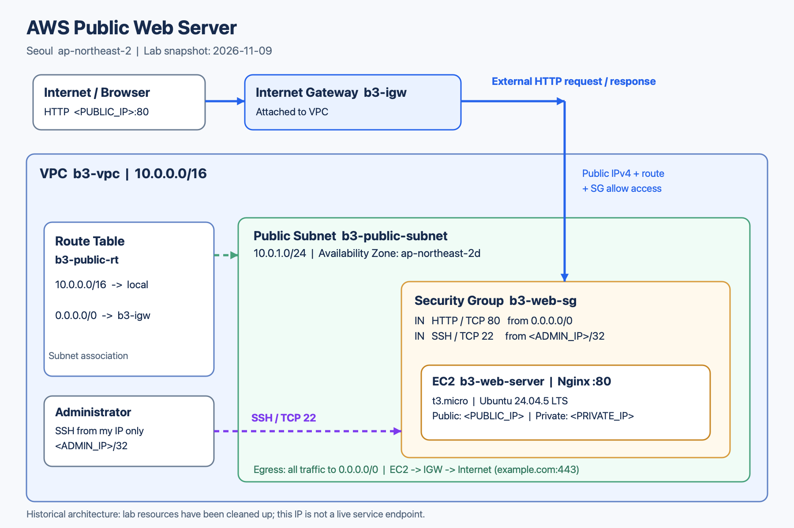

외부 브라우저의 HTTP 요청은 인터넷 게이트웨이를 통해 Public Subnet의 EC2로 전달되고, 보안 그룹에서 허용된 TCP 80 포트의 Nginx가 응답합니다. 인터넷 게이트웨이는 VPC에 연결하고, 사용자 지정 라우팅 테이블 `b3-public-rt`를 Public Subnet에 명시적으로 연결했습니다.

| 라우팅 목적지 | 대상 | 용도 |
| --- | --- | --- |
| `10.0.0.0/16` | `local` | VPC 내부 통신 |
| `0.0.0.0/0` | `b3-igw` (`<IGW_ID>`) | 인터넷 방향 통신 |

보안 그룹 `b3-web-sg`의 규칙은 다음과 같습니다.

| 방향 | 유형 | 프로토콜 / 포트 | 소스 또는 대상 |
| --- | --- | --- | --- |
| 인바운드 | HTTP | TCP 80 | `0.0.0.0/0` |
| 인바운드 | SSH | TCP 22 | 실습 당시 내 IP `<ADMIN_IP>/32` |
| 아웃바운드 | 모든 트래픽 | 전체 | `0.0.0.0/0` |

인바운드 전체 포트를 인터넷에 개방하지 않고 HTTP와 내 IP의 SSH만 허용했습니다. 보안 그룹은 인스턴스의 네트워크 트래픽을 제어하고, IAM은 AWS 리소스를 생성·조회·변경하는 권한을 제어합니다.

IAM은 실습자 확인에 따르면 EC2·VPC 구성에 필요한 범위로 제한했습니다. 제출된 캡처에는 연결 정책 상세가 없어 정책별 허용 작업과 관리자 권한 미부여 여부를 별도로 검증하지는 못했습니다.

<details>
<summary>네트워크·보안 설정 증빙</summary>

기본 라우트와 VPC 내부 경로:

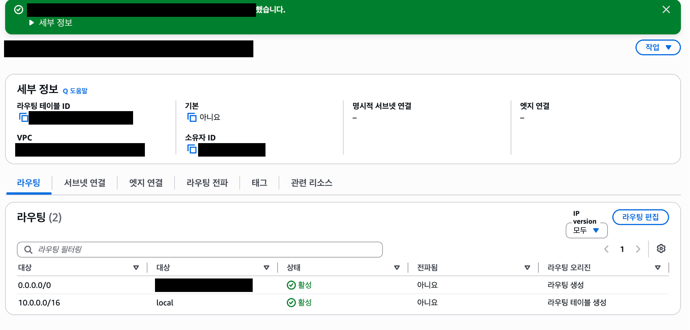

Public Subnet과 라우팅 테이블의 명시적 연결:

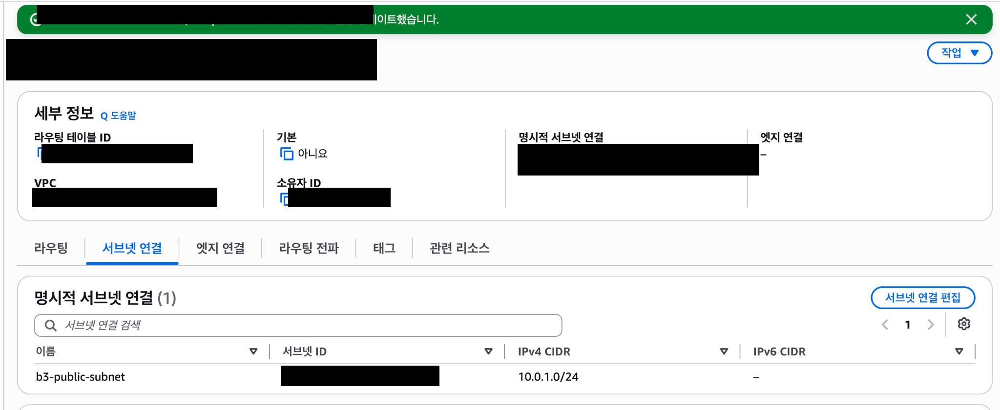

보안 그룹 생성 시 설정한 HTTP·SSH 인바운드 규칙:

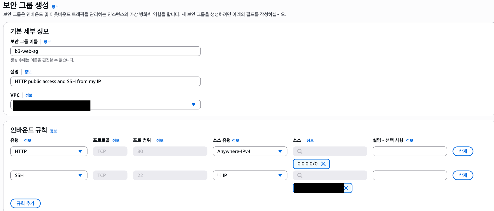

</details>

## SSH 접속 및 Nginx 설치

아래 SSH 명령과 서비스 실행·상태 확인은 캡처에 남은 실행 기록입니다. `apt` 명령은 설치 과정을 재현하기 위한 안내이며, 설치 명령 자체의 캡처는 없습니다.

로컬 터미널에서 키 권한을 제한한 뒤 접속합니다. 아래 `PUBLIC_IP`는 실제 접속 주소로 대체하는 자리표시자입니다.

```bash
chmod 400 ~/Downloads/b3-key.pem
ssh -i ~/Downloads/b3-key.pem ubuntu@PUBLIC_IP
```

EC2 내부에서 Nginx를 설치하고 실행합니다.

```bash
sudo apt update
sudo apt install -y nginx
sudo systemctl enable --now nginx
sudo systemctl status nginx --no-pager
```

서비스 상태에서 `enabled` 및 `active (running)`을 확인했습니다.

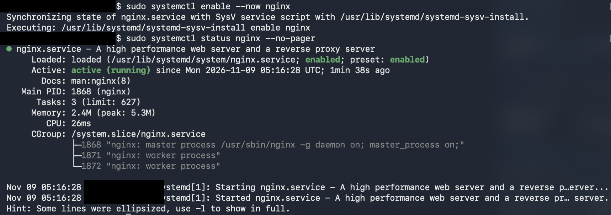

<details>
<summary>EC2·EBS 사양과 SSH 접속 증빙</summary>

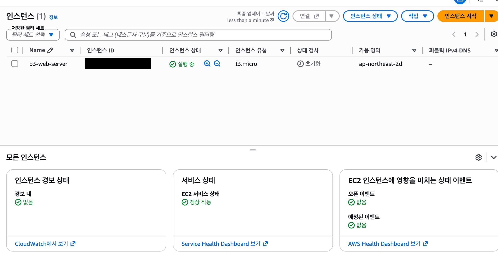

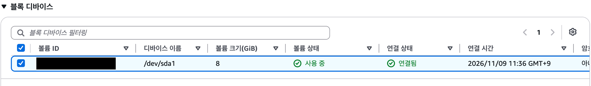

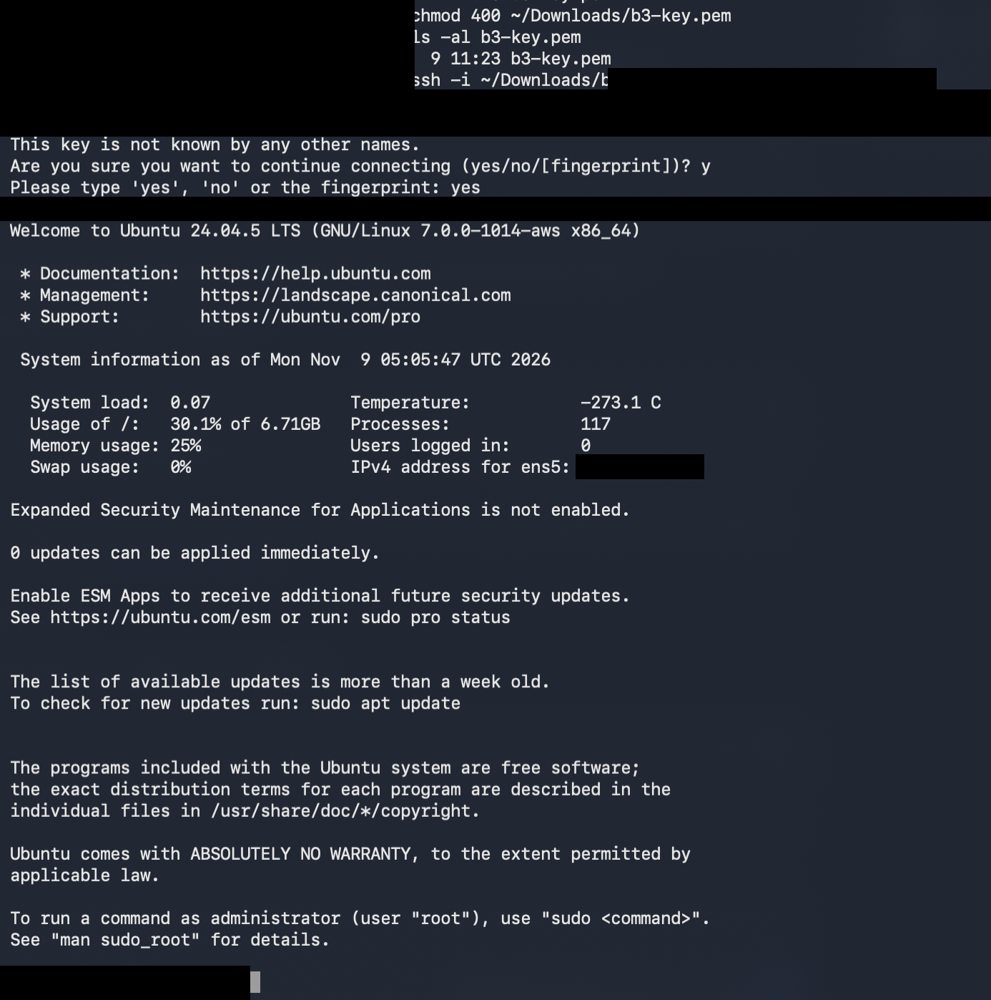

</details>

## 서버 내부 및 인터넷 통신 검증

EC2에서 다음 명령을 실행했습니다. `-I`는 HEAD 요청으로 응답 헤더를 확인하는 옵션입니다.

```bash
curl -I http://localhost
curl -I https://example.com
```

| 검증 | 캡처에서 확인한 결과 |
| --- | --- |
| EC2 → 로컬 Nginx | `HTTP/1.1 200 OK`, `Server: nginx/1.24.0 (Ubuntu)` |
| EC2 → 외부 인터넷 | `HTTP/2 200` |

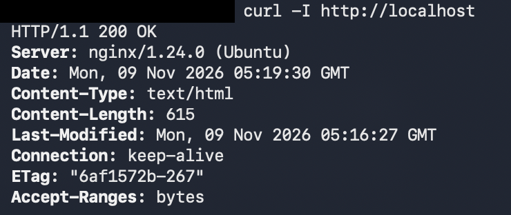

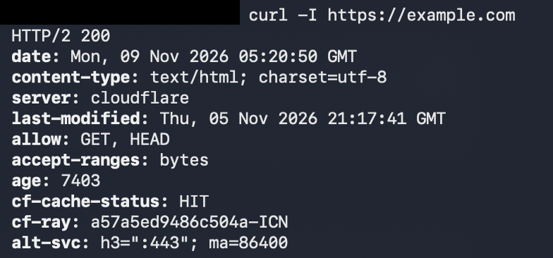

## 외부 접속 검증

- **선택한 방식: (A) 브라우저 접속**
- **실습 당시 접속 URL: `http://<PUBLIC_IP>`**
- 검증 결과: 로컬 브라우저에서 EC2의 퍼블릭 IP로 접속하여 **Welcome to nginx!** 기본 페이지가 정상 표시됨을 확인했습니다.
- 아래 캡처에는 브라우저 주소창과 Nginx 페이지가 함께 보이며, 실제 IP와 개인 브라우저 정보는 가렸습니다. 공개본에서는 실제 접속 주소를 확인할 수 없습니다. HTTP로 검증했으며 HTTPS 및 Docker 보너스 과제는 수행 범위에 포함하지 않았습니다.

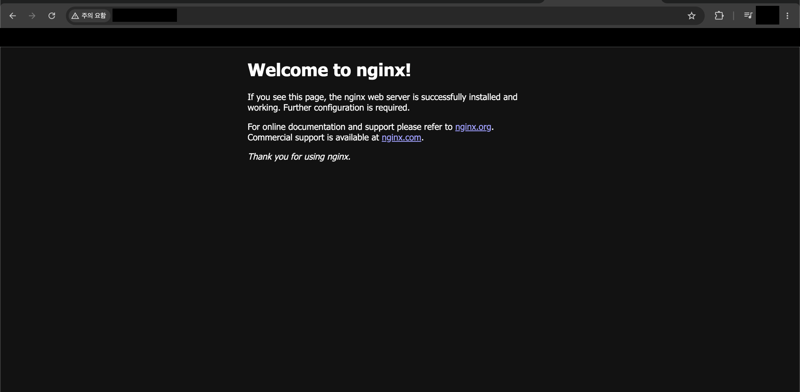

## 트러블슈팅 및 실습 종료

재사용하려던 인스턴스에서 중지 대신 종료(삭제)를 선택하여 다시 시작할 수 없게 된 사례를 [트러블슈팅 보고서](docs/troubleshooting.md)에 기록했습니다. 기존 인스턴스를 재생성하거나 서비스를 복구하지는 않았습니다.

EC2의 최종 상태는 **종료됨**으로 확인했습니다. 나머지 실습 리소스는 실습자가 정리 완료를 확인했으며, 항목별 근거와 확인 범위는 [리소스 정리 체크리스트](docs/cleanup-checklist.md)에 정리했습니다.

## 참고

- [과제 요구사항](https://app.notion.com/p/b3-1-40ea7db0628e80cbb81bf7bb7e8fa22e?source=copy_link)
- [AWS: 인스턴스 중지 및 시작](https://docs.aws.amazon.com/AWSEC2/latest/UserGuide/Stop_Start.html)
- [AWS: EC2 FAQ — 중지 상태에서도 EBS 저장 비용 발생 가능](https://aws.amazon.com/ec2/faqs/)
