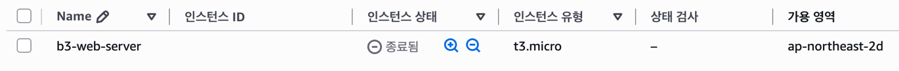

# 리소스 정리 체크리스트

실습일: 2026-11-09 · 리전: 서울 (`ap-northeast-2`)

실습자는 생성한 실습 리소스를 모두 정리했다고 확인했다. 아래 체크 표시는 그 확인을 반영한다. EC2 종료와 보안 그룹·서브넷·VPC 삭제, 인터넷 게이트웨이 분리·삭제는 콘솔 캡처로 확인했다. 키페어는 1개 삭제 완료 알림을 확보했다. EBS·Elastic IP·사용자 지정 라우팅 테이블은 별도 삭제 캡처 없이 실습자 확인을 근거로 기록했다.

공개용 캡처는 계정·리소스 ID 등 식별정보를 배경색으로 가리고 불필요한 여백을 잘랐다. 완료 문구와 상태는 원본 그대로 유지했다.

## 정리 결과

| 완료 | 대상 | 실습 당시 이름 / ID | 결과 및 확인 근거 |
| --- | --- | --- | --- |
| [x] | EC2 | `b3-web-server` / `<INSTANCE_ID>` | 최종 상태 ‘종료됨’을 아래 콘솔 캡처에서 확인. 중지 상태가 아님. |
| [x] | EBS | `<VOLUME_ID>` / 8GiB | 삭제 완료 — 실습자의 전체 리소스 정리 완료 확인에 근거. 볼륨 삭제 화면은 미첨부. |
| [x] | Elastic IP | 할당 ID 증빙 없음 | 실습자의 전체 리소스 정리 완료 확인에 따라 잔여 항목 없음으로 기록. 미할당인지 할당 후 해제인지 구분할 자료는 없음. |
| [x] | 사용자 지정 보안 그룹 | `b3-web-sg` | [삭제 완료 알림](#보안-그룹-삭제)으로 확인. |
| [x] | Public Subnet | `b3-public-subnet` / `<SUBNET_ID>` | [삭제 완료 알림](#public-subnet-삭제)으로 확인. |
| [x] | 사용자 지정 라우팅 테이블 | `b3-public-rt` / `<ROUTE_TABLE_ID>` | 삭제 완료 — 실습자 확인. |
| [x] | Internet Gateway | `b3-igw` / `<IGW_ID>` | [VPC 분리 및 삭제 완료 알림](#인터넷-게이트웨이-분리삭제)으로 확인. |
| [x] | VPC | `b3-vpc` / `<VPC_ID>` | [삭제 완료 알림](#vpc-삭제)으로 확인. |
| [x] | 키페어 | 삭제 알림에 이름 미표시 | [키페어 1개 삭제 완료 알림](#키페어-삭제)으로 확인. 알림만으로 특정 키페어 이름까지 확인할 수는 없음. |

## EC2 종료 완료 증빙

‘종료 중’ 단계 이후 최종 ‘종료됨’ 상태를 확인한 화면이다.

## 추가 정리 증빙

### 보안 그룹 삭제

`b3-web-sg` 삭제 완료 알림이다.

### Public Subnet 삭제

실습 서브넷 삭제 완료 알림이다. 식별정보는 가렸다.

### 인터넷 게이트웨이 분리·삭제

VPC에서 `b3-igw`를 분리한 뒤 인터넷 게이트웨이를 삭제한 각각의 완료 알림이다.

### VPC 삭제

`b3-vpc`와 기타 리소스 1개를 삭제했다는 알림이다. 기타 리소스의 종류는 화면에 표시되지 않아 사용자 지정 라우팅 테이블의 개별 삭제 증빙으로 사용하지 않았다.

### 키페어 삭제

키페어 1개 삭제 완료 알림이다. 삭제된 키페어의 이름은 이 화면에 표시되지 않는다.

## 확인 범위

- 외부 접속 및 설정 증빙은 리소스 정리 전에 확보했다.
- EC2 종료만으로 다른 리소스의 삭제 여부까지 증명되는 것은 아니다. 네트워크 리소스는 추가 알림을 연결했고, EBS·Elastic IP·사용자 지정 라우팅 테이블은 위 표에 실습자 확인 근거를 따로 표시했다.
- NAT Gateway·ELB/ALB·RDS는 제공된 실습 구성에 포함되지 않았다. 계정 전체의 다른 리소스를 조회한 결과는 아니다.
- Billing Dashboard 화면은 제공되지 않았다. 최종 청구 금액 또는 계정 전체의 과금 항목이 없다는 사실까지 검증한 기록은 아니다.
- 재사용을 위한 일시 중지는 최종 정리와 구분한다. 실습 최종 정리에서는 인스턴스를 종료하고 잔여 EBS 등도 확인한다.
