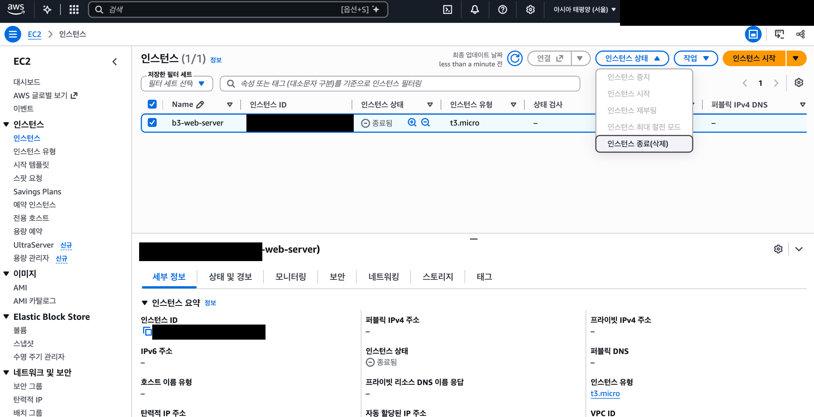

# 트러블슈팅 — 중지와 종료를 혼동한 인스턴스 재사용 실패

실습일: 2026-11-09

대상: `b3-web-server` (`<INSTANCE_ID>`)

| 항목 | 내용 |
| --- | --- |
| 증상 | 인스턴스를 다시 사용할 생각이었으나, ‘중지’ 대신 ‘종료(삭제)’를 선택하여 기존 인스턴스를 다시 시작할 수 없게 되었다. |
| 가설 | 일시적으로 멈추는 중지가 아니라 인스턴스를 영구 삭제하는 종료를 실행한 것이 원인으로 판단되었다. |
| 검증 | EC2 콘솔에서 인스턴스 상태가 ‘종료됨’인 것을 확인했다. 인스턴스 상태 메뉴의 ‘시작’과 ‘중지’가 비활성화되어 있었다. AWS 문서에서도 종료된 인스턴스는 다시 시작할 수 없음을 확인했다. |
| 조치 | 종료 상태와 재시작 불가를 확인했다. 실습의 외부 접속 증빙은 확보한 상태였으므로 인스턴스를 재생성하지 않고 최종 리소스 정리로 마무리했다. |
| 결과 | 기존 인스턴스는 재사용할 수 없으며 서비스 복구는 수행하지 않았다. 원인이 네트워크 설정이 아닌 인스턴스 수명 주기 작업의 선택에 있음을 확인했다. |
| 재발 방지 | 다시 사용할 예정이면 ‘중지’를 선택한다. 최종 실습 종료 시에는 필요한 증빙과 데이터를 먼저 확보한 뒤 ‘종료(삭제)’를 선택하고 잔여 리소스를 정리한다. 실행 전 대상 인스턴스와 작업 이름을 재확인한다. 중지 중에도 EBS 등 잔여 리소스 비용이 발생할 수 있으므로 별도로 확인한다. |

## 검증 화면

인스턴스의 ‘종료됨’ 상태와 ‘인스턴스 시작’ 메뉴 비활성화를 확인할 수 있다.

## 참고

- [AWS: 인스턴스 상태 변경](https://docs.aws.amazon.com/AWSEC2/latest/UserGuide/ec2-instance-lifecycle.html) — 종료된 인스턴스는 영구 삭제되어 다시 시작할 수 없다.
- [AWS: EC2 FAQ](https://aws.amazon.com/ec2/faqs/) — 중지 상태의 인스턴스에도 EBS 저장 비용은 발생할 수 있다.

이 기록은 실수와 원인 확인에 대한 보고이며, 서비스 복구 성공을 의미하지 않는다.
